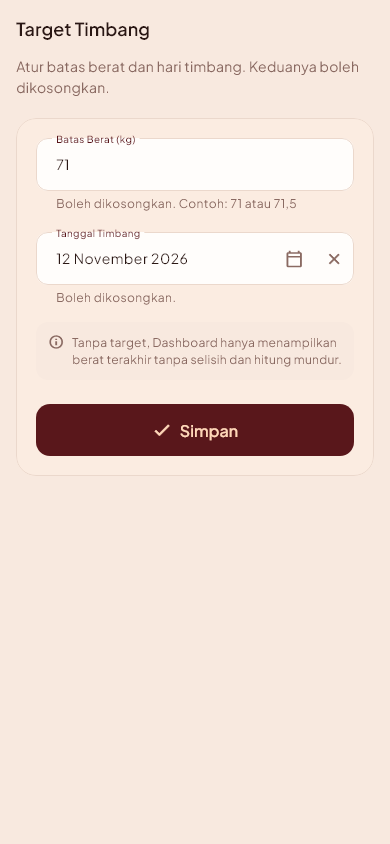
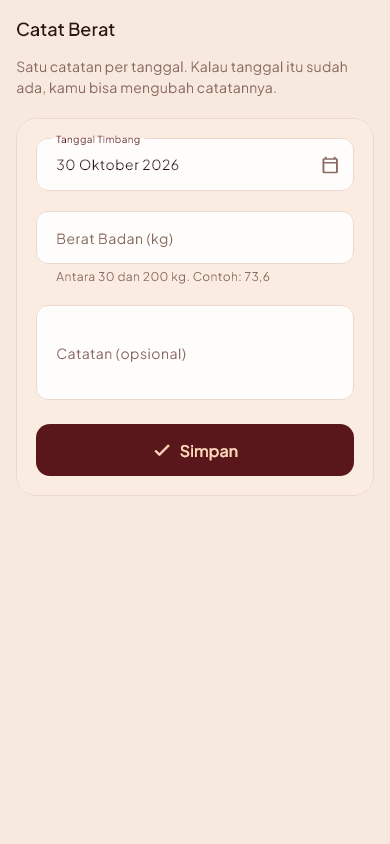
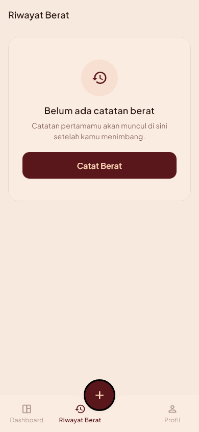
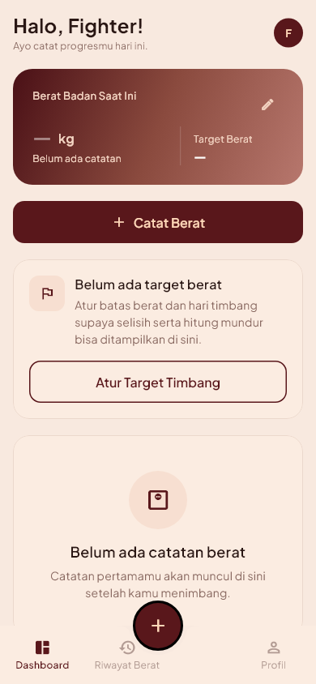

# WeFight — Weight for Fight Tracker

Aplikasi mobile dan web untuk memantau berat badan menuju hari timbang pertandingan
Muay Thai. Pengguna mencatat berat harian, mengatur batas berat kelas dan tanggal
timbang, lalu melihat selisih berat serta hitung mundur ke hari timbang dalam satu
layar.

Proyek individu mata kuliah **Mobile and Web Application Development**
(Sistem Informasi, semester ganjil 2026/2027).

## Identitas

- Nama: Rasyiditya Inoriboeing Santosa
- NIM: 23.01.55.0013
- Kelas: A1 / A2DLC
- Judul aplikasi: WeFight: Weight for Fight Tracker
- Nama project Flutter: `wefight`

## Tautan

- Desain Figma (wireframe Minggu 4):
  https://www.figma.com/design/je3J8Dtm45YIgMLQylv0CP/
- Repository GitHub: https://github.com/masb0i/WeFight
- **Aplikasi online (Firebase Hosting): https://wefight-38409.web.app**
  (cadangan: https://wefight-38409.firebaseapp.com)

## Masalah yang diselesaikan

Berat badan biasanya dicatat di aplikasi catatan biasa: tidak ada hitung mundur ke
hari timbang dan tidak ada selisih ke batas berat. Akibatnya pengguna baru sadar
beratnya masih jauh dari batas ketika waktu sudah mepet. WeFight menampilkan tiga
angka itu sekaligus — berat terakhir, selisih ke batas, dan sisa hari.

## Fitur (sesuai prioritas MoSCoW Minggu 2)

| Prioritas | Fitur |
|---|---|
| **Must** | Login · Dashboard (berat terakhir, selisih, hitung mundur, grafik tren) · Target Timbang · Catat Berat · Riwayat Berat |
| **Should** | Daftar akun · Profil + Keluar · lupa kata sandi · filter riwayat |
| **Won't now** | multi-target/pertandingan · notifikasi · ekspor data · lebih dari satu catatan per hari · saran kesehatan apa pun |

Aplikasi **hanya menampilkan data** — tidak memberi saran diet, rehidrasi, atau
*water cut*.

## Cara menjalankan

Versi online tidak perlu instalasi apa pun: buka **https://wefight-38409.web.app**
lalu masuk dengan akun demo di bawah.

Menjalankan sendiri:

```bash
git clone https://github.com/masb0i/WeFight.git
cd WeFight
flutter pub get
flutter run -d chrome        # versi web
flutter run                  # emulator/perangkat Android
```

Pemeriksaan kualitas:

```bash
flutter analyze
flutter test                 # 144 test
flutter build web            # build produksi
firebase deploy --only hosting   # unggah build/web ke Hosting
```

Tidak ada langkah Firebase tambahan yang wajib: aturan keamanan sudah terpasang
dan query aplikasi tidak memerlukan indeks komposit. Kalau Dashboard atau
Riwayat menampilkan **"Gagal memuat data"**, itu berarti datanya tidak berhasil
diambil (bukan berarti catatannya kosong) — tekan **"Coba lagi"**, dan pastikan
perangkat terhubung internet serta `firestore.rules` sudah ter-deploy.

### Akun demo

Data simulasi diisi dengan skrip (bukan diketik manual):

```bash
dart run tool/seed_demo.dart              # tulis/perbarui data demo
dart run tool/seed_demo.dart --bersihkan  # + hapus catatan di luar data demo
dart run tool/cek_isolasi.dart            # buktikan data terisolasi per akun
```

| Akun | Email | Kata sandi | Isi |
|---|---|---|---|
| Demo | `fighter@wefight.demo` | `wefight123` | Target 71 kg, hari timbang 14 hari ke depan, 6 catatan 76,4 → 73,6 kg |
| Pembanding | `rival@wefight.demo` | `wefight123` | Kosong — untuk membuktikan data terisolasi |

Skrip ini idempoten — menjalankannya dua kali menimpa data yang sama, bukan
menduplikasi. **Jalankan `--bersihkan` sebelum demo** kalau sebelumnya sudah
mencoba menambah catatan lewat aplikasi: catatan uji coba bisa bertanggal sama
dengan data demo sehingga Riwayat tampak dobel dan Dashboard memilih angka lain.

## Tangkapan layar

<table>
  <tr>
    <td><br><sub>Login</sub></td>
    <td><br><sub>Dashboard (mobile)</sub></td>
    <td><br><sub>Riwayat Berat (daftar)</sub></td>
    <td><br><sub>Profil</sub></td>
  </tr>
  <tr>
    <td><br><sub>Target Timbang (form)</sub></td>
    <td><br><sub>Catat Berat (tambah)</sub></td>
    <td colspan="2" valign="top"><sub>Form Target Timbang: batas berat (angka) dan tanggal timbang
      (<code>showDatePicker</code>). Kedua kolom boleh dikosongkan — menyimpan form kosong berarti
      menghapus target, bukan menghasilkan galat.<br><br>
      Form Catat Berat: tanggal terisi hari ini, berat 30–200 kg, catatan opsional. Kalau tanggal
      itu sudah punya catatan, aplikasi menawarkan mengubah catatan lama — tidak pernah membuat
      duplikat.</sub></td>
  </tr>
  <tr>
    <td><br><sub>Riwayat Berat (kosong)</sub></td>
    <td colspan="3" valign="top"><sub>Daftar Riwayat: urut tanggal terbaru, satu kartu per catatan.
      Ketuk kartu untuk mengubah, ikon hapus meminta konfirmasi lebih dulu. Kolom perubahan
      menunjukkan selisih terhadap catatan sebelumnya.<br><br>
      Setiap halaman punya keadaan kosong yang menjelaskan dan mengarahkan, bukan layar kosong
      (PLAN §10).</sub></td>
  </tr>
  <tr>
    <td><br><sub>Dashboard (belum ada data)</sub></td>
    <td colspan="3" valign="top"><sub>Dashboard menghitung sendiri dari data yang ada: berat terakhir dari catatan
      terbaru, selisih terhadap batas berat (<code>2.6 kg di atas batas</code> / <code>Tepat di batas</code> /
      <code>1 kg di bawah batas</code>), dan hitung mundur hari timbang (<code>14 hari lagi</code> /
      <code>Hari ini hari timbang</code> / <code>Hari timbang terlewat 3 hari</code>).<br><br>
      Keadaan kosong juga ditangani: angka tampil <code>—</code>, kartu "Atur Target Timbang" hanya
      muncul bila target memang belum diisi, dan tidak ada angka yang dikarang.<br><br>
      Grafik tren (<code>fl_chart</code>) hanya muncul setelah ada 2 catatan — dengan 0 atau 1
      catatan, kartunya menampilkan "Data belum cukup". Garis putus-putus adalah batas berat.</sub></td>
  </tr>
</table>

Versi web (sidebar + area konten dua kolom):


Perilaku per lebar layar:

| Lebar | Navigasi | Dashboard | Aksi "Catat Berat" |
|---|---|---|---|
| < 600 px | Bottom nav 3 destinasi | Satu kolom | FAB melayang di tengah, di atas bar + tombol di konten |
| 600–1023 px | Sidebar ringkas (ikon) | Satu kolom, maks 720 px | Tombol di konten |
| ≥ 1024 px | Sidebar 240 px + label | **Dua kolom** (3 : 2) | Tombol di konten (Dashboard), kanan atas header (Riwayat) |

Isi menu, urutan, label aksi, palet, dan pesan kosong tidak berubah antar breakpoint.
Diuji otomatis pada 360 / 768 / 1440 px (`test/widget_test.dart`, grup `Responsif`).

Tangkapan layar dibuat otomatis dari pohon widget aplikasi (bukan hasil foto layar),
sehingga selalu sesuai kode terakhir:

```bash
flutter test --update-goldens tool/render_screens_test.dart
```

Hasilnya tersimpan di `docs/screenshots/` (15 gambar: mobile, tablet, web).

Foto layar yang diambil manual — bukan hasil render — disimpan terpisah di
`docs/bukti/`, mis. [`p6-flutter-run-chrome.png`](docs/bukti/p6-flutter-run-chrome.png)
sebagai bukti aplikasi berjalan lewat `flutter run -d chrome`.

## Pengujian

**144 test**, semuanya lulus tanpa Firebase (Auth dan Firestore diganti fake):

| Berkas | Isi |
|---|---|
| `test/widget_test.dart` | 76 widget test: kerangka & guard login, validasi form autentikasi, Target Timbang, Catat Berat (termasuk aturan satu catatan per tanggal dan mode ubah), Riwayat Berat, ringkasan Dashboard, grafik tren, keadaan galat, geometri navigasi bawah, responsif 360/768/1440 px |
| `test/validators_test.dart` | 21 unit test `Validators` — batas 30 dan 200 kg diuji **inklusif**, koma desimal, dan target yang boleh kosong |
| `test/weight_math_test.dart` | 19 unit test `WeightMath` — selisih 0/positif/negatif, pembulatan satu desimal, sisa hari 0 dan negatif |
| `test/weight_log_test.dart` | 8 unit test `urutkanTerbaruDulu` — urutan tanggal terbaru dulu, tanggal sama, daftar masukan tidak berubah, hasil tidak bisa diubah pemanggil |
| `test/models_test.dart` | 20 unit test model `Target`/`WeightLog`/`UserProfile` — pembacaan peta Firestore, data rusak menjadi null, dan penulisan `uid` |

Logika yang bisa salah tanpa terlihat di layar (aritmetika selisih, hitung mundur, validasi rentang) diuji sebagai fungsi murni lebih dulu, baru ditempel ke widget. Tampilan yang tidak bisa dijamin test — label terpotong, tombol melebar, teks bertumpuk — ditangkap lewat render golden di atas.

Selain test otomatis, [`docs/UJI_FORM.md`](docs/UJI_FORM.md) mencatat **32 kasus uji form** beserta hasil yang diharapkan dan hasil nyatanya: 24 dibuktikan test, 8 dicoba manual (login/daftar sungguhan, kalender, menghapus tanggal, membuka id yang sudah dihapus). Seluruhnya berstatus sesuai.

## Struktur project

```
lib/
  main.dart                 # bootstrap Firebase + ProviderScope
  app/                      # MaterialApp.router, router (guard login), tema
  core/
    constants/              # warna, gradient, jarak, teks, route, nama menu
    utils/                  # date_format, angka, weight_math, validators
    widgets/                # AppScaffold, AppCard, PrimaryButton, EmptyState, ...
  pages/                    # SATU FILE PER HALAMAN (H1–H7)
    splash_page.dart        #   Splash
    login_page.dart         #   H1 Login
    daftar_page.dart        #   H2 Daftar
    dashboard_page.dart     #   H3 Dashboard
    target_timbang_page.dart#   H4 Target Timbang
    catat_berat_page.dart   #   H5 Catat Berat
    riwayat_berat_page.dart #   H6 Riwayat Berat
    profil_page.dart        #   H7 Profil
  features/                 # data, model, dan provider per fitur
    auth/  target/  weight_log/  dashboard/  profile/
tool/
  render_screens_test.dart  # render layar jadi PNG
  seed_demo.dart            # isi data simulasi (REST)
  cek_isolasi.dart          # buktikan data terisolasi per akun
docs/                       # rencana, spesifikasi UI, panduan, screenshot
```

Halaman ada di `lib/pages/` sesuai modul Minggu 6. Lapisan data dipisah per fitur
(`models/`, `data/`, `presentation/*_providers.dart`) supaya kode Firestore tidak
tercampur dengan kode tampilan.

## Teknologi

| Bagian | Pilihan | Alasan |
|---|---|---|
| Framework | Flutter 3.47 / Dart 3.13 | Satu kode untuk Android dan web |
| State | Riverpod 3 | Tanpa `BuildContext`, mudah diuji |
| Navigasi | GoRouter 18 | Guard login di satu tempat, mendukung URL web |
| Database | Cloud Firestore | Real-time, cocok untuk dashboard yang langsung terbarui |
| Autentikasi | Firebase Auth (email/password) | Tidak perlu backend sendiri |
| Grafik | fl_chart 1.3 | Satu garis tren, ringan |
| Hosting | Firebase Hosting | Satu proyek dengan database |

## Keamanan data

Setiap pengguna hanya bisa membaca dan menulis dokumennya sendiri. Aturannya ada di
[`firestore.rules`](firestore.rules) dan dipasang dengan:

```bash
firebase deploy --only firestore:rules
```

Isolasi antar akun diuji otomatis, bukan hanya diperiksa manual:

```bash
dart run tool/cek_isolasi.dart    # 5 pemeriksaan: akun B ditolak membaca/menulis data akun A
```

**Catatan tentang API key Firebase.** `lib/firebase_options.dart` dan
`android/app/google-services.json` memang berisi API key, dan file itu ikut
di-commit. API key Firebase bukan rahasia — nilainya sudah terkirim di setiap
permintaan dari aplikasi web mana pun, dan yang menjaga data adalah aturan
keamanan Firestore di atas, bukan kerahasiaan key. Yang tidak pernah masuk
repository: kata sandi akun, service account key, dan token pribadi.

## Catatan penyimpangan dari modul

Beberapa hal sengaja berbeda dari modul praktik, dengan alasan yang bisa
dipertanggungjawabkan:

1. **Warna primer burgundy `#59171B`, bukan navy `#1F3A5F` dari style guide mini
   Minggu 4.** Pemilik proyek mengganti acuan visual ke gambar referensi sendiri
   (gradient burgundy–peach) karena style guide Minggu 4 dinilai terlalu sederhana.
   Gradient, kartu, dan hero mengikuti referensi tersebut; aturan lain dari Minggu 4
   (jarak kelipatan 8, margin 16, status selalu berteks) tetap dipakai.
   Rincian: [`docs/UI_SPEC.md`](docs/UI_SPEC.md).
2. **Firebase sudah terpasang pada pertemuan 7**, padahal modul menempatkannya
   setelah UTS. Form Login dan Daftar sudah tersambung ke Firebase Auth, dan
   Dashboard membaca data dari Firestore. Ini urutan yang lebih cepat, bukan
   fitur tambahan di luar scope: daftar fitur tetap sama dengan Minggu 2.
3. **Memakai paket dari pub.dev** (Riverpod, GoRouter, fl_chart) sejak awal, bukan
   hanya widget bawaan. Modul melarangnya untuk Minggu 6–7 karena keterbatasan
   waktu kelas; di proyek ini paket tersebut menggantikan kode yang harus ditulis
   sendiri (state management dan routing).

## Dokumen perencanaan

| Berkas | Isi |
|---|---|
| [`docs/ARTEFAK_UTS.md`](docs/ARTEFAK_UTS.md) | Artefak Discover & Design (problem statement, persona, user story, MoSCoW, use case, user flow, sitemap, navigasi) + tabel ketertelusuran ke kode dan kasus uji |
| [`docs/PLAN.md`](docs/PLAN.md) | Spesifikasi, aturan bisnis, arsitektur, milestone M5–M16, checklist tugas |
| [`docs/PROGRESS.md`](docs/PROGRESS.md) | Log progres per tugas (append-only) |
| [`docs/UI_SPEC.md`](docs/UI_SPEC.md) | Token warna, tipografi, komponen, tata letak web & mobile |
| [`docs/FIREBASE_SETUP.md`](docs/FIREBASE_SETUP.md) | Panduan setup Firebase dari nol |
| [`docs/UJI_FORM.md`](docs/UJI_FORM.md) | Tabel uji form (kasus, hasil yang diharapkan, hasil nyata) |
