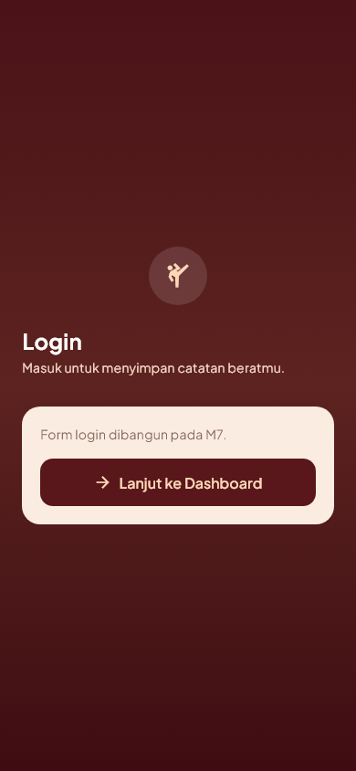
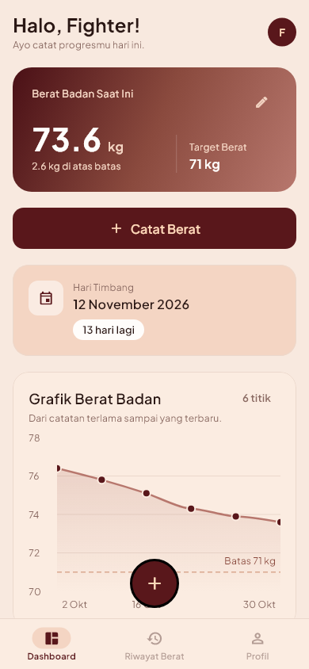
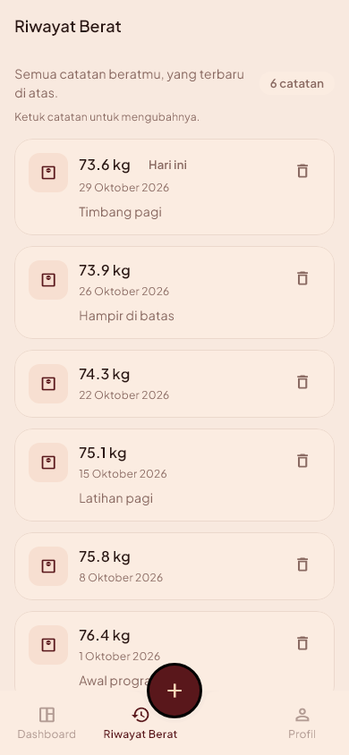
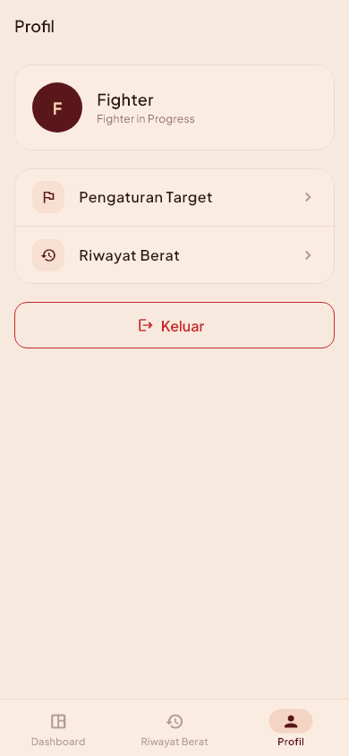
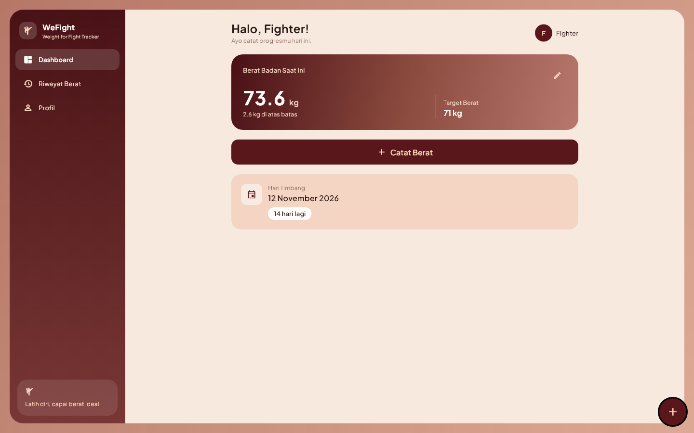

# WeFight — Weight for Fight Tracker

Aplikasi mobile dan web untuk memantau berat badan menuju hari timbang pertandingan
Muay Thai. Pengguna mencatat berat harian, mengatur batas berat kelas dan tanggal
timbang, lalu melihat selisih berat serta hitung mundur ke hari timbang dalam satu
layar.

Proyek individu mata kuliah **Mobile and Web Application Development**
(Sistem Informasi, semester ganjil 2026/2027).

## Identitas

- Nama: Rasyiditya Inoriboeing Santosa
- NIM: 23.01.55.0013
- Kelas: A1 / A2DLC
- Judul aplikasi: WeFight: Weight for Fight Tracker
- Nama project Flutter: `wefight`

## Tautan

- Desain Figma (wireframe Minggu 4):
  https://www.figma.com/design/je3J8Dtm45YIgMLQylv0CP/
- Repository GitHub: _(diisi setelah repository dibuat)_
- Aplikasi online (Firebase Hosting): _(diisi pada pertemuan 16)_

## Masalah yang diselesaikan

Berat badan biasanya dicatat di aplikasi catatan biasa: tidak ada hitung mundur ke
hari timbang dan tidak ada selisih ke batas berat. Akibatnya pengguna baru sadar
beratnya masih jauh dari batas ketika waktu sudah mepet. WeFight menampilkan tiga
angka itu sekaligus — berat terakhir, selisih ke batas, dan sisa hari.

## Fitur (sesuai prioritas MoSCoW Minggu 2)

| Prioritas | Fitur |
|---|---|
| **Must** | Login · Dashboard (berat terakhir, selisih, hitung mundur, grafik tren) · Target Timbang · Catat Berat · Riwayat Berat |
| **Should** | Daftar akun · Profil + Keluar · lupa kata sandi · filter riwayat |
| **Won't now** | multi-target/pertandingan · notifikasi · ekspor data · lebih dari satu catatan per hari · saran kesehatan apa pun |

Aplikasi **hanya menampilkan data** — tidak memberi saran diet, rehidrasi, atau
*water cut*.

## Cara menjalankan

```bash
flutter pub get
flutter run -d chrome        # versi web
flutter run                  # emulator/perangkat Android
```

Pemeriksaan kualitas:

```bash
flutter analyze
flutter test                 # 31 test
flutter build web            # build produksi
```

### Akun demo

Data simulasi diisi dengan skrip (bukan diketik manual):

```bash
dart run tool/seed_demo.dart
```

| Akun | Email | Kata sandi |
|---|---|---|
| Demo | `fighter@wefight.demo` | `wefight123` |
| Pembanding (untuk uji isolasi) | `rival@wefight.demo` | `wefight123` |

Akun demo berisi target 71 kg, hari timbang 14 hari ke depan, dan 6 catatan berat
76,4 → 73,6 kg. Skrip ini idempoten — menjalankannya dua kali menimpa data yang sama.

## Tangkapan layar

<table>
  <tr>
    <td><br><sub>Login</sub></td>
    <td><br><sub>Dashboard (mobile)</sub></td>
    <td><br><sub>Riwayat Berat</sub></td>
    <td><br><sub>Profil</sub></td>
  </tr>
</table>

Versi web (sidebar + area konten dua kolom):



Tangkapan layar dibuat otomatis dari pohon widget aplikasi (bukan hasil foto layar),
sehingga selalu sesuai kode terakhir:

```bash
flutter test --update-goldens tool/render_screens_test.dart
```

Hasilnya tersimpan di `docs/screenshots/` (9 gambar: mobile, tablet, web).

## Struktur project

```
lib/
  main.dart                 # bootstrap Firebase + ProviderScope
  app/                      # MaterialApp.router, router (guard login), tema
  core/
    constants/              # warna, gradient, jarak, teks, route, nama menu
    utils/                  # date_format (kunci yyyy-MM-dd), validators
    widgets/                # AppScaffold, AppCard, PrimaryButton, EmptyState, ...
  pages/                    # SATU FILE PER HALAMAN (H1–H7)
    splash_page.dart        #   Splash
    login_page.dart         #   H1 Login
    daftar_page.dart        #   H2 Daftar
    dashboard_page.dart     #   H3 Dashboard
    target_timbang_page.dart#   H4 Target Timbang
    catat_berat_page.dart   #   H5 Catat Berat
    riwayat_berat_page.dart #   H6 Riwayat Berat
    profil_page.dart        #   H7 Profil
  features/                 # data, model, dan provider per fitur
    auth/  target/  weight_log/  dashboard/  profile/
tool/
  render_screens_test.dart  # render layar jadi PNG
  seed_demo.dart            # isi data simulasi (REST)
  cek_isolasi.dart          # buktikan data terisolasi per akun
docs/                       # rencana, spesifikasi UI, panduan, screenshot
```

Halaman ada di `lib/pages/` sesuai modul Minggu 6. Lapisan data dipisah per fitur
(`models/`, `data/`, `presentation/*_providers.dart`) supaya kode Firestore tidak
tercampur dengan kode tampilan.

## Teknologi

| Bagian | Pilihan | Alasan |
|---|---|---|
| Framework | Flutter 3.47 / Dart 3.13 | Satu kode untuk Android dan web |
| State | Riverpod 3 | Tanpa `BuildContext`, mudah diuji |
| Navigasi | GoRouter 18 | Guard login di satu tempat, mendukung URL web |
| Database | Cloud Firestore | Real-time, cocok untuk dashboard yang langsung terbarui |
| Autentikasi | Firebase Auth (email/password) | Tidak perlu backend sendiri |
| Grafik | fl_chart 1.3 | Satu garis tren, ringan |
| Hosting | Firebase Hosting | Satu proyek dengan database |

## Keamanan data

Setiap pengguna hanya bisa membaca dan menulis dokumennya sendiri. Aturannya ada di
[`firestore.rules`](firestore.rules) dan dipasang dengan:

```bash
firebase deploy --only firestore:rules
```

Isolasi antar akun diuji otomatis, bukan hanya diperiksa manual:

```bash
dart run tool/cek_isolasi.dart    # 5 pemeriksaan: akun B ditolak membaca/menulis data akun A
```

**Catatan tentang API key Firebase.** `lib/firebase_options.dart` dan
`android/app/google-services.json` memang berisi API key, dan file itu ikut
di-commit. API key Firebase bukan rahasia — nilainya sudah terkirim di setiap
permintaan dari aplikasi web mana pun, dan yang menjaga data adalah aturan
keamanan Firestore di atas, bukan kerahasiaan key. Yang tidak pernah masuk
repository: kata sandi akun, service account key, dan token pribadi.

## Catatan penyimpangan dari modul

Beberapa hal sengaja berbeda dari modul praktik, dengan alasan yang bisa
dipertanggungjawabkan:

1. **Warna primer burgundy `#59171B`, bukan navy `#1F3A5F` dari style guide mini
   Minggu 4.** Pemilik proyek mengganti acuan visual ke gambar referensi sendiri
   (gradient burgundy–peach) karena style guide Minggu 4 dinilai terlalu sederhana.
   Gradient, kartu, dan hero mengikuti referensi tersebut; aturan lain dari Minggu 4
   (jarak kelipatan 8, margin 16, status selalu berteks) tetap dipakai.
   Rincian: [`docs/UI_SPEC.md`](docs/UI_SPEC.md).
2. **Firebase sudah terpasang pada pertemuan 7**, padahal modul menempatkannya
   setelah UTS. Form Login dan Daftar sudah tersambung ke Firebase Auth, dan
   Dashboard membaca data dari Firestore. Ini urutan yang lebih cepat, bukan
   fitur tambahan di luar scope: daftar fitur tetap sama dengan Minggu 2.
3. **Memakai paket dari pub.dev** (Riverpod, GoRouter, fl_chart) sejak awal, bukan
   hanya widget bawaan. Modul melarangnya untuk Minggu 6–7 karena keterbatasan
   waktu kelas; di proyek ini paket tersebut menggantikan kode yang harus ditulis
   sendiri (state management dan routing).

## Dokumen perencanaan

| Berkas | Isi |
|---|---|
| [`docs/PLAN.md`](docs/PLAN.md) | Spesifikasi, aturan bisnis, arsitektur, milestone M5–M16, checklist tugas |
| [`docs/PROGRESS.md`](docs/PROGRESS.md) | Log progres per tugas (append-only) |
| [`docs/UI_SPEC.md`](docs/UI_SPEC.md) | Token warna, tipografi, komponen, tata letak web & mobile |
| [`docs/FIREBASE_SETUP.md`](docs/FIREBASE_SETUP.md) | Panduan setup Firebase dari nol |
| [`docs/UJI_FORM.md`](docs/UJI_FORM.md) | Tabel uji form (kasus, hasil yang diharapkan, hasil nyata) |
